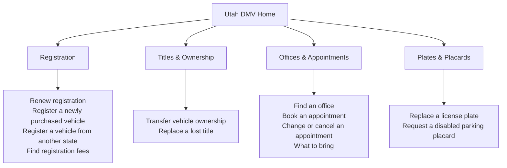

# Revised Utah DMV Sitemap

This sitemap shows where people can find registration, title, office, appointment, plate, and placard services on the redesigned Utah DMV website.

| Navigation | Where it appears | Links and behavior |
|---|---|---|
| Primary | Header on every page | Registration, Titles & Ownership, Offices & Appointments, and Plates & Placards |
| Secondary | Each section’s landing page | Direct links to the action items shown in the sitemap |
| Utility | Header and footer | Search in the header. Contact DMV and Update mailing address in the footer. |
| Homepage shortcuts | Main content | Renew registration, Register a vehicle from another state, and Book an appointment. Place a smaller Find an office link beside booking. |
| Contextual | Within task pages | Breadcrumbs show the current section. Office details show hours and walk-in availability and link to booking when available. Titles & Ownership links to out-of-state registration. Renewal links to fees and address updates. |
